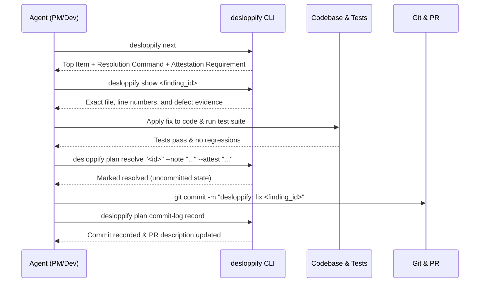

# Desloppify Next: Execution Engine Runbook

`desloppify-next` drives the focused, zero-hesitation execution loop. It takes the top item from the active execution queue, guides the precise code correction, verifies the fix, and records the resolution.

---

## 1. The Core Execution Loop



---

## 2. Step-by-Step Execution Protocol

### Step 1: Pull Next Priority Finding
Run:
```bash
desloppify next
```
*Advanced queue filters:*
- To view the top 5 items: `desloppify next --count 5`
- To focus on an auto-grouped cluster: `desloppify next --cluster <cluster_name>`

### Step 2: Deep-Dive into the Defect
Never guess what needs fixing. Inspect the exact evidence and context:
```bash
desloppify show <finding_id>
```
Identify the finding's tier:
- **T1 (Mechanical/Autofixable)**: Check if an auto-fixer is available. Run `desloppify autofix <fixer> --dry-run` to preview, then apply.
- **T2 (Quick Manual)**: Unused imports, dead variables, trivial dead branches. Fix directly.
- **T3 (Judgment Call)**: Missing error handling, leaky abstractions, vague function contracts. Apply clean engineering patterns.
- **T4 (Major Refactor)**: Structural smells, cyclic dependencies. Ensure comprehensive test coverage before modifying call sites.

### Step 3: Implement Code Fix & Verify
1. Edit the target source files.
2. Maintain backward compatibility and preserve all unrelated comments/docstrings.
3. Run project unit tests and linters to verify the fix:
   - Python: `pytest`
   - Node: `npm test` / `pnpm test`
   - Go: `go test ./...`

### Step 4: Attest and Resolve Finding
Desloppify enforces honest resolution via required attestation strings. Run the exact resolution command generated by `desloppify next`:
```bash
desloppify plan resolve "<pattern_or_id>" \
  --note "Brief description of fix" \
  --attest "I have actually removed or resolved this issue in code."
```
> [!IMPORTANT]
> Never attest to an issue you have not physically modified and verified in the codebase. False attestations violate tool integrity.

### Step 5: Git Commit & Commit-Log Tracking
Group related fixes into clean atomic commits:
```bash
git add <modified_files>
git commit -m "desloppify: resolve <finding_id> - <brief summary>"
desloppify plan commit-log record
```
`desloppify plan commit-log record` transitions resolved findings from `uncommitted` to `committed` and auto-updates the linked PR description.

---

## 3. Queue Discipline Rules

- **Do NOT rescan mid-queue**: Rescanning resets context and triggers cascade calculations. Grind through the active batch first.
- **Temporary Score Dips are Normal**: As dead code or broken abstractions are removed, transient cascade effects can temporarily adjust intermediate scores. Continue executing the queue.
- **When the Queue is Empty**: Rescan the project with `desloppify scan` to surface newly unblocked issues or confirm final strict score gains.
