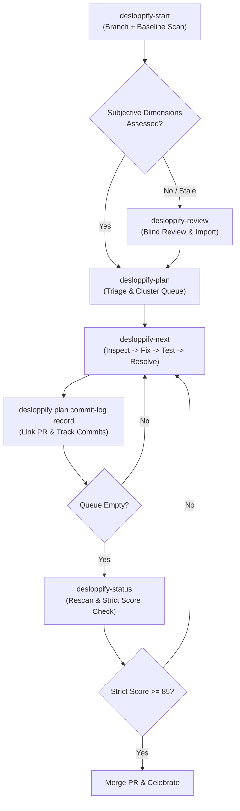

# Desloppify: Codebase Health & Technical Debt Engine

`desloppify` tracks, scores, and guides the systematic elimination of codebase debt across 30+ programming languages. It balances automated mechanical detectors with structured subjective quality reviews.

---

## 1. Core Operating Principles

1. **North Star is the Strict Score**:
   - **Score Composition**: `25% Mechanical` (auto-detected dead code, syntax smells, duplicate clusters, security vulnerabilities) + `75% Subjective` (design elegance, contracts, abstraction hygiene, error handling).
   - **Strict vs. Lenient**: Strict score counts `wontfix` / skipped items as open technical debt. Never optimize the lenient score at the expense of strict health.
   - **Target**: Default production bar is **85.0+ Strict**.
2. **Never Commit Directly to Main**:
   - Always isolate codebase health campaigns on dedicated branches: `git checkout -b desloppify/code-health`.
3. **Follow the Execution Queue**:
   - Do not invent cleanup tasks or perform ad-hoc refactorings. Run the deterministic workflow loop: **Scan → Plan → Execute (`next`) → Resolve → Rescan**.
4. **Fix Upstream Tool Deficiencies**:
   - If language linters or compilers fail (e.g., missing ESLint plugins, syntax parser failures), resolve environment configuration upstream before running scans.

---

## 2. Differentiated Sub-Skills & Invocations

Depending on the task, invoke or transition to the specialized sub-skills:

| Skill / Command | Primary Purpose | When to Use |
| :--- | :--- | :--- |
| **`desloppify-start`** (`/desloppify-start`) | **Project Initialization & Baseline** | First-time onboarding, creating cleanup branches, configuring monorepo zones, running baseline scans. |
| **`desloppify-next`** (`/desloppify-next`) | **Tactical Execution Engine** | Pulling the top execution item, inspecting defects, applying code fixes, attesting resolution, and recording commit logs. |
| **`desloppify-plan`** (`/desloppify-plan`) | **Strategic Queue & Backlog Triage** | Running structured triage stages (`observe`, `reflect`, `organize`, `strategy`), clustering issues, and reordering. |
| **`desloppify-review`** (`/desloppify-review`) | **Subjective Quality Evaluation** | Running blind LLM/subagent reviews across design, elegance, and contract dimensions (the 75% pool). |
| **`desloppify-status`** (`/desloppify-status`) | **Health Telemetry & Dashboard** | Auditing score gaps, inspecting dimension drags, generating treemaps (`viz`), and updating scorecard badges. |

---

## 3. The End-to-End Health Lifecycle



---

## 4. CLI Quick Command Reference

```bash
# Baseline & Scans
desloppify scan --path .                         # Scan current directory
desloppify scan --path ./subproject --lang ts    # Multi-project / monorepo target
desloppify status                                # Full score & dimension dashboard

# Execution Queue
desloppify next                                  # Top priority execution item
desloppify next --count 5                        # Top 5 queued execution items
desloppify next --cluster <name>                 # Focus execution on a specific cluster
desloppify show <issue_id_or_path>               # Deep-dive into specific defect

# Resolution & Attestation
desloppify plan resolve "<pattern>" --note "why" --attest "I have verified..."
desloppify plan commit-log record                # Move resolved findings from uncommitted to committed

# Plan & Triage
desloppify plan queue                            # Compact execution queue table
desloppify plan cluster create <name>            # Group related issues into a batch
desloppify plan reorder <cluster_or_id> top      # Escalate priority

# Subjective Review
desloppify review --prepare                      # Generate query.json for subjective assessment
desloppify review --import <findings>.json       # Import completed review findings
```
